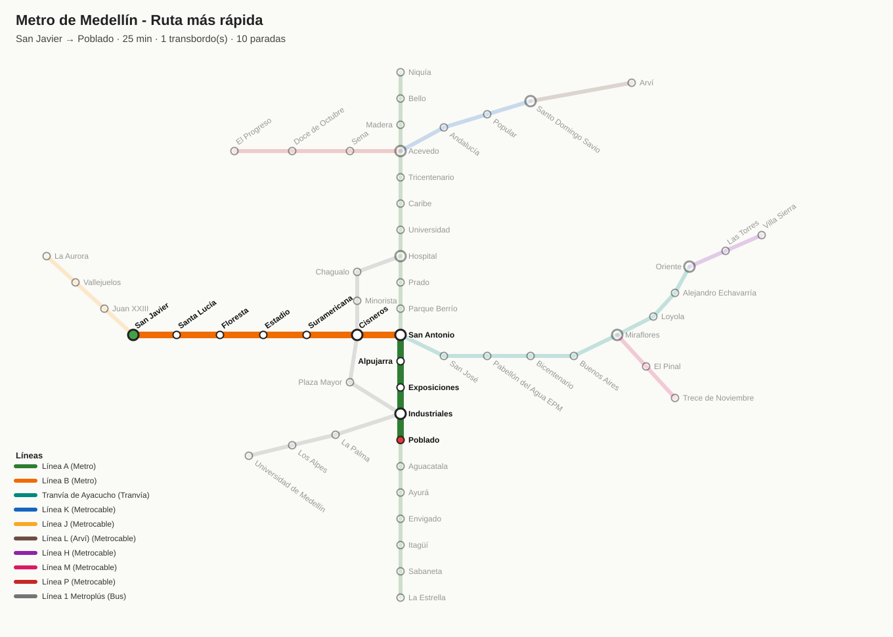

# Navegador de Rutas del Metro de Medellín

Práctica 2 de Estructuras de Datos y Algoritmos (Universidad EAFIT, 2026).

Programa en C++ que modela la red del Metro de Medellín como un grafo y busca la ruta más rápida entre dos estaciones con el algoritmo de Dijkstra. La ruta se muestra en consola y se exporta como mapa (SVG) y como archivo de Graphviz (DOT).



## Funcionalidades

- Cargar la red desde archivos de texto (líneas A y B, Tranvía, Metrocables y Línea 1 de Metroplús).
- Ruta más rápida con Dijkstra usando un montículo binario propio.
- Ruta con menos transbordos.
- Cerrar y abrir estaciones (las rutas las esquivan).
- Estaciones alcanzables en X minutos, ordenadas con Quick Sort.
- Agregar estaciones, líneas y conexiones desde el menú.
- Búsqueda de estaciones sin importar tildes ni mayúsculas.
- Exportar la red completa o una ruta a SVG y DOT.

## Cómo compilar y correr

Se necesita g++ con soporte de C++17 (por ejemplo el de MSYS2 en Windows).

```bash
g++ -std=c++17 -O2 -static src/main.cpp src/grafo.cpp src/rutas.cpp src/exportar.cpp -o navegador_metro.exe
./navegador_metro.exe
```

También se puede abrir la carpeta en CLion (usa el `CMakeLists.txt`) o darle doble clic a `compilar.bat`.

El programa lee los datos de la carpeta `datos/` y guarda los mapas en `salidas/`.

## Estructura

| Archivo | Qué hace |
|---|---|
| `src/grafo.h`, `src/grafo.cpp` | Estructuras del grafo, carga de archivos y búsqueda de estaciones |
| `src/rutas.h`, `src/rutas.cpp` | Montículo, Dijkstra, ruta con menos transbordos, alcanzables e impresión en consola |
| `src/exportar.h`, `src/exportar.cpp` | Exportación a SVG y DOT |
| `src/main.cpp` | Menú del programa |
| `datos/` | Líneas, estaciones y conexiones de la red |

Los tiempos entre estaciones son aproximados y las coordenadas del mapa son esquemáticas.

## Integrantes

Andrés Ramírez · Kenny Diaz · David Rodríguez
